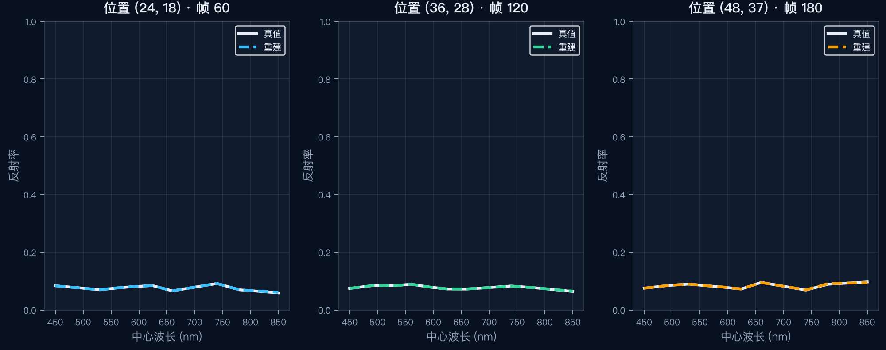

# ChromaCode

中文 | [English](README.en.md)

**用时间编码探索单传感器多光谱成像。**

ChromaCode 是一个多光谱成像研究项目。它通过对不同波段的照明进行时间编码，让多路光谱响应共享同一个传感器，再从混合观测中重建各波段的反射率。对于面阵传感器，这一过程可以逐像素应用，形成多光谱图像。

*仿真示例：从左到右为参考图像、重建图像和误差热图。*

## 项目在做什么

- **编码采集**：让多路照明共用一条传感路径，并在重建时分离各波段响应。
- **逐像素重建**：将单点的光谱恢复方法扩展到图像，探索多光谱图像与视频。
- **两种处理方式**：流式解调持续更新结果；分块重建联合处理一段曝光序列，输出该时间窗口的结果。
- **校准与背景建模**：利用参考采集和背景模型，在满足假设时减小部分误差来源。

输出是指定 LED 照明波段的有效反射率，并非任意连续光谱。分块结果也不等同于每个相机帧独立测得的一张多光谱图。

## 仿真展示

下图分别展示仿真中的波段误差和选定像素的重建结果。它们来自特定合成场景，不代表所有材料、光照或运动条件下的精度。

*仿真示例：各波段反射率均方根误差。*

*仿真示例：选定像素的参考与重建波段值。*

### 动态场景

*合成运动场景的逐波段重建与误差展示，并非真实运动实验。*

### 流式输出

*单像素混合信号与流式波段估计的仿真示例。*

## 当前进展

- **背景与时序**：研究照明编码、曝光时间和环境光干扰对重建的影响。
- **通道与动态性**：比较固定光子和时间预算下的通道数，并探索窗口内变化的模型；更多通道或更复杂的模型并不保证更高精度。
- **计算与内存**：一次单线程 CPU 测量中，128 帧、1920 × 1080 像素、32 波段的合成 uint16 输入，重建中位时间为 **0.349 秒**，进程峰值内存为 **0.97 GB**。计时包含输入转换，不包含相机采集、I/O、模型构建或校准；这不是端到端视频帧率。

## 状态与联系

项目仍在研究中，目前展示的结果来自仿真，尚不构成真实相机精度或应用部署的验证。农业、工业检测、文化遗产分析和机器人视觉等均是潜在方向。

本仓库用于项目介绍、图片和演示，不发布源代码或技术文档。如有合作或许可意向，欢迎通过 Issue 联系。
