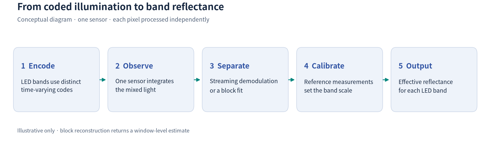
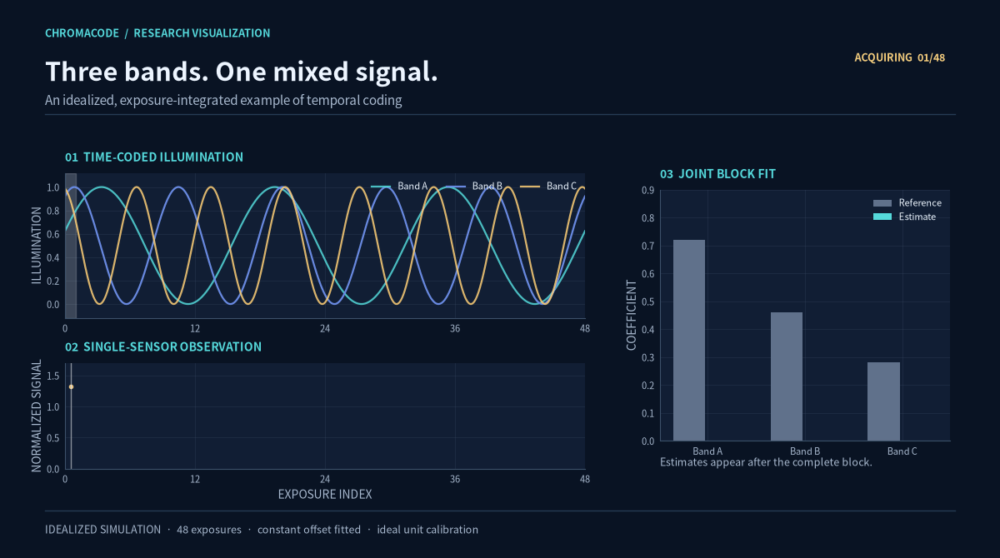
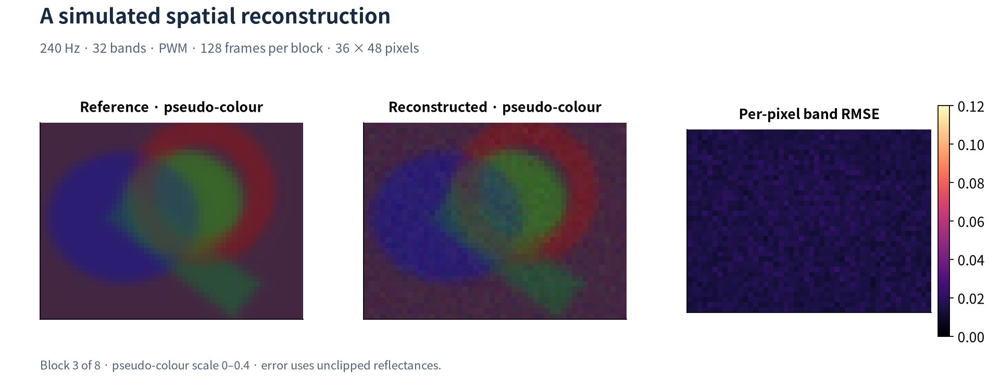
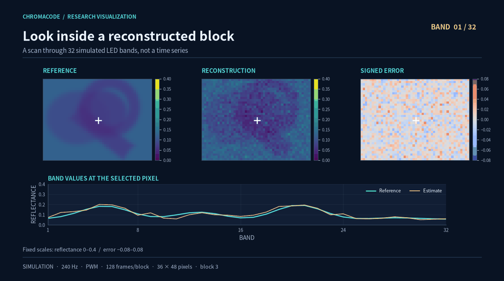
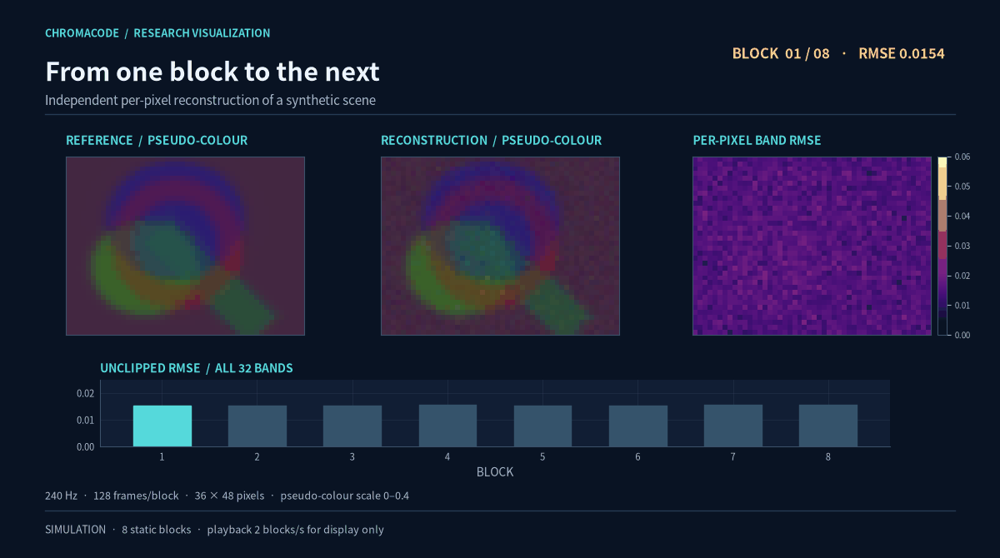
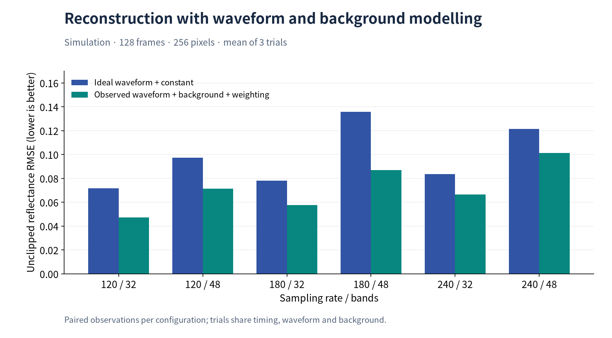
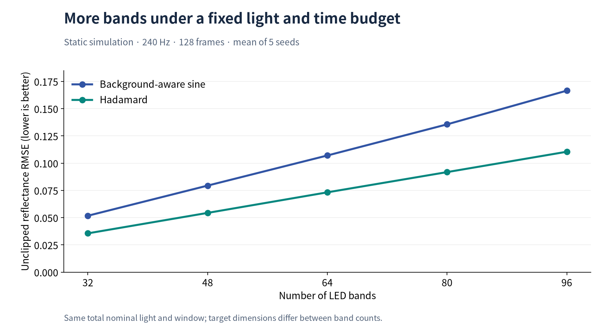
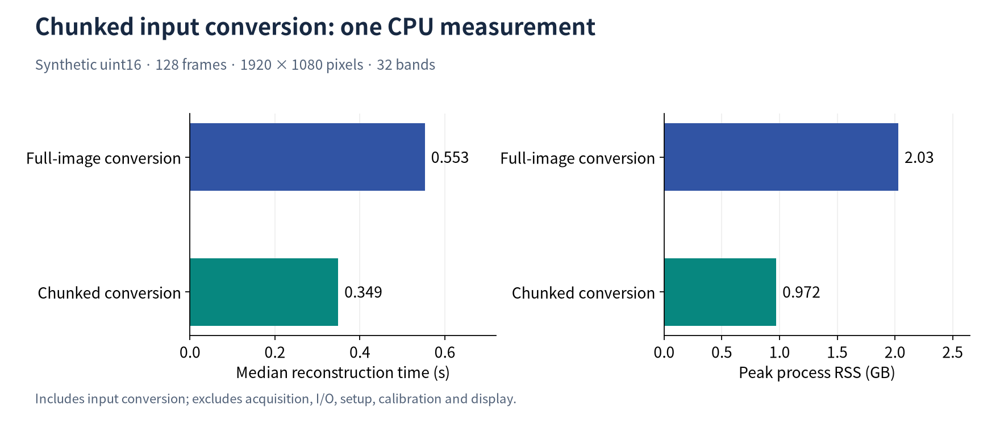

# ChromaCode

English | [中文](README.zh.md)

**Multispectral reflectance from time-coded illumination and a single sensor.**

ChromaCode explores how multiple LED illumination bands can share one sensing path. Each band is modulated over time; a receiver separates their contributions from the mixed measurements and uses a reference capture to estimate band reflectance. The same idea can be applied independently to every pixel of an area sensor.

> **Research status:** the reconstruction and accuracy examples below are simulations with assumed hardware parameters. The CPU timing is a software benchmark on synthetic inputs. Neither establishes real-camera accuracy or end-to-end video performance.



## What is being recovered?

The output is **effective reflectance for the configured LED illumination bands**. Each value depends on the LED spectrum, sensor response, optical path and calibration; it is not an arbitrary continuous spectrum or a high-resolution spectral measurement. A sensor can be a single detector or a camera array: using one sensor does not mean that an image is formed from only one pixel.

The project studies encoding, calibration, signal separation, channel count, temporal behaviour and reconstruction cost together. Potential applications include agriculture, industrial inspection, cultural-heritage analysis and robotic vision; these are research directions, not validated deployments.

## How it works

### Measurement and calibration

During each exposure, the sensor integrates the light reflected from all active LEDs. For one pixel and a scene that is approximately constant over a block, a simplified model is:



*Idealized, noise-free illustration: 48 exposure-integrated observations of three bands, with a constant offset fitted jointly. The estimate appears after the complete block; playback is not a measurement of system speed.*

```math
y_t = \sum_{c=1}^{C} A_{tc}a_c + \sum_{j=1}^{P} B_{tj}b_j + \varepsilon_t,
\qquad A_{tc} = \int_{\text{exposure }t} L_c(\tau)\,d\tau.
```

Here `y` is the mixed observation, `L` is a band’s illumination waveform, `a` contains band coefficients including optical and sensor gains, `B` describes background terms, and `ε` represents noise and model mismatch. The exposure-integrated design can come from an ideal waveform or from separately measured LED traces. A reference with known band reflectance sets the scale of the target coefficients; changes in illumination, geometry or sensor gain between reference and target can still produce errors.

For block reconstruction, the receiver jointly fits illumination and nuisance columns, optionally weighting frames by an independently estimated noise variance. It uses SVD-based solving and checks rank and conditioning: **more observations or background columns do not automatically make a design identifiable**. The frame weights are a shared approximation, not a per-pixel Poisson likelihood.

### Encoding and processing

| Component | Approach | Important trade-off |
|---|---|---|
| Illumination | Sine/IQ, PWM, Hadamard and time-division codes are explored in different experiments. | Codes must be distinguishable after exposure integration and within power limits. |
| Streaming | Lock-in demodulation with FIR or IIR filtering updates band estimates as samples arrive. | Update rate is not the same as recoverable scene bandwidth; filtering adds settling time and delay. |
| Block | Jointly fit a sequence of exposures, then calibrate the band coefficients. | A result describes a window, not a separate multispectral measurement for every camera frame. |
| Background | Fit selected offsets, drift or known-frequency flicker along with illumination. | Extra columns consume degrees of freedom and may amplify noise or conflict with illumination. |
| Temporal model | Optionally add a linear change term per band within a block. | It adds parameters and cannot generally recover abrupt changes or motion. |

For example, 128 frames at 240 Hz correspond to a nominal **0.533 s non-overlapping block period**, before reconstruction and other system delays. Shorter windows can reduce latency but offer fewer observations and photons. A frequency planner can account for known background and noise when selecting sinusoidal carriers; it is greedy, not a guarantee of globally optimal codes.

## Simulated reconstruction



This example uses 32 PWM-coded bands, 128 frames per block at 240 Hz, a 12-bit sensor model and a **36 × 48 pixel synthetic scene**. Pixels have independent noisy observations and are reconstructed independently. The object changes position between blocks but is static inside each block; this is not a continuous-motion test.

The figure shows block 3 of 8. Pseudo-colour combines three fixed groups of bands on a shared 0–0.4 display scale; it is **not natural RGB**. The error map is per-pixel RMSE across bands, computed from unclipped reflectances. Across all eight blocks the simulated RMSE is **0.0154**. This scene uses separate reference captures, shot/read noise, exposure jitter and LED clock offset; it does not include the ambient flicker used in the experiments below. Results from these separate experiments should not be directly compared.



*A scan through all 32 bands of the same block, not a time series. The cross marks the pixel shown in the lower plot; connecting band values is only a visual guide, not a continuous spectrum. Signed error is reconstruction minus reference. Image colours use fixed, clipped display scales; the underlying results are not clipped.*



*The eight independently reconstructed blocks, with per-block RMSE computed over all pixels and bands. Playback at 2 blocks/s is for display only; it is not the measured capture or processing rate.*

## Accuracy and channel trade-offs

All RMSE values below are **unclipped reflectance RMSE** against simulated truth; `0.01` corresponds to roughly one percentage point of reflectance. These are aggregate results for specified scenarios, not guaranteed per-band accuracy.

### Modelling waveforms and background



Each configuration uses 128 frames, 256 pixels and three trials. The compared receivers share the same target observations and an averaged reference. The synthetic illumination has phase offsets, harmonics and response curvature; the optical traces are noiseless and synchronized. Exposure duration varies, and the simulated ambient light has a known 50 Hz flicker. Approximate weights use the reference and a fixed target-reflectance prior, not the target truth. The trials share timing, waveform and background; only target reflectance and sensor noise are regenerated.

| Sampling rate | Bands | Ideal waveform + constant background | Observed waveform + integrated background + weighting |
|---|---:|---:|---:|
| 120 Hz | 32 | 0.07157 | 0.04719 |
| 120 Hz | 48 | 0.09738 | 0.07130 |
| 180 Hz | 32 | 0.07815 | 0.05769 |
| 180 Hz | 48 | 0.13578 | 0.08702 |
| 240 Hz | 32 | 0.08342 | 0.06639 |
| 240 Hz | 48 | 0.12142 | 0.10137 |

The combined model reduces RMSE by approximately **16–36%** in these configurations. That comparison changes multiple elements at once; it does not prove that each change helps independently. Different sampling rates use different observation durations. Unknown flicker frequencies, noisy optical monitoring and real hardware remain to be tested.

### Increasing the number of bands



This separate static simulation fixes the frame rate at 240 Hz, window at 128 frames, nominal exposure fraction at 0.8, and total mean white-signal rate at 1.2 million electrons/s. It uses 128 pixels, a 12-bit ADC model, ambient light at 80,000 electrons/s with 80% modulation at a known 50 Hz, four reference captures and five random seeds per configuration. An individual LED peak limit of 100,000 electrons/s was imposed but not reached in these cases.

| LED bands | Background-aware sine | Hadamard |
|---:|---:|---:|
| 32 | 0.05178 | 0.03562 |
| 48 | 0.07943 | 0.05439 |
| 64 | 0.10706 | 0.07325 |
| 80 | 0.13563 | 0.09182 |
| 96 | 0.16656 | 0.11050 |

Values are five-seed means; all 50 runs succeeded without target or reference saturation. Five seeds are not enough for reliable confidence intervals. With fixed total light and time, this simulation shows an increasing error as the available light is divided among more bands. Different band counts use different-dimensional synthetic targets, not paired measurements of identical bands. **96 simulated bands is not a demonstrated hardware limit or capability.**

### Changes within a window

Another simulation compares static and linear temporal fits using the same code and observations within each row. The metric is RMSE against the exposure-weighted block mean, averaged over three seeds; all examples use 240 Hz, 128 pixels, a 12-bit ADC model and known 50 Hz background.

| Frames / bands | Code | Synthetic change | Static fit | Linear fit |
|---|---|---|---:|---:|
| 64 / 16 | Hadamard | Static | 0.03274 | 0.03343 |
| 64 / 16 | Hadamard | Linear ramp | 0.05091 | 0.03334 |
| 64 / 24 | Time-aware sine | Step | 0.09536 | 0.21847 |
| 128 / 32 | Hadamard | Linear ramp | 0.05275 | 0.03698 |
| 128 / 48 | Hadamard | Step | 0.08131 | 0.08827 |

The linear model helps some ramps but adds noise in static scenes and can be worse for steps. Across the wider scan, 288 of 432 runs succeeded and 144 were rejected for insufficient degrees of freedom, rank deficiency or poor conditioning. These are repeated simulation configurations, not independent hardware failures; passing a conditioning check also does not establish dynamic accuracy.

## Reconstruction performance



The following is a **software-only CPU comparison**, not an imaging accuracy experiment. It uses random synthetic `uint16` input, 128 frames, 1920 × 1080 pixels and 32 output bands. Input conversion and reconstruction use float32; design and calibration setup are performed beforehand.

| Input conversion | Median time / block | Peak process RSS |
|---|---:|---:|
| Full-image float32 conversion | 0.553 s | 2.03 GB |
| Conversion in 4096-pixel chunks | 0.349 s | 0.972 GB |

The local measurement used one CPU thread on an Intel i9-9900K, Python 3.12.16, NumPy 2.5.5 and OpenBLAS 0.3.34. Each path was measured five times after warm-up in separate processes, without interleaving or isolation from shared-machine load. Peak RSS includes setup, warm-up and validation. For both paths, the first 1,024 pixels differed from a float64 receiver by at most `5.83 × 10⁻⁶`; this is a numerical comparison, **not** physical reflectance error.

Timing includes input conversion, reconstruction, output allocation and calibration ratios, but excludes acquisition, camera I/O, design construction, SVD, reference fitting and display. Residual diagnostics were disabled. The input and full output arrays remain in memory. These numbers do not establish camera-to-display latency or real-time video throughput.

## Limitations and next steps

- **Hardware:** real LED waveforms, sensor spectral response, synchronization, dropped frames, saturation and temperature drift need measurement.
- **Calibration:** reference noise, geometry, nonlinearity and changes between reference and target can bias estimates; fitted background does not remove its photon shot noise.
- **Dynamics:** static block models assume little change within a window. Linear terms only approximate limited changes and do not recover per-frame multispectral images.
- **Scaling:** channel count, light budget, conditioning, acquisition time and motion sensitivity must be evaluated together; results from one configuration do not generalize automatically.
- **Validation:** experiments on physical targets and cameras are needed before making accuracy or deployment claims.

## About this repository

This repository contains the project overview and visual material. The core implementation and technical documentation are not published here. For collaboration or licensing enquiries, please open an issue.
