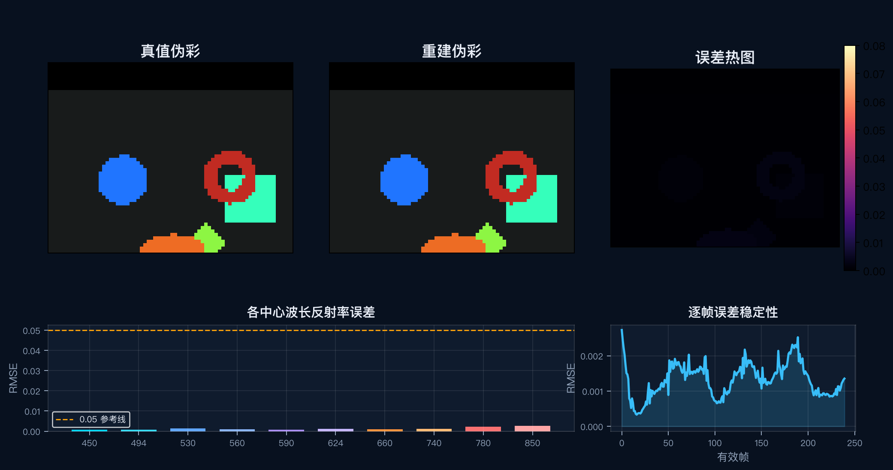
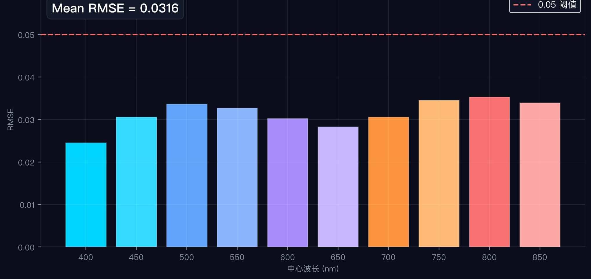
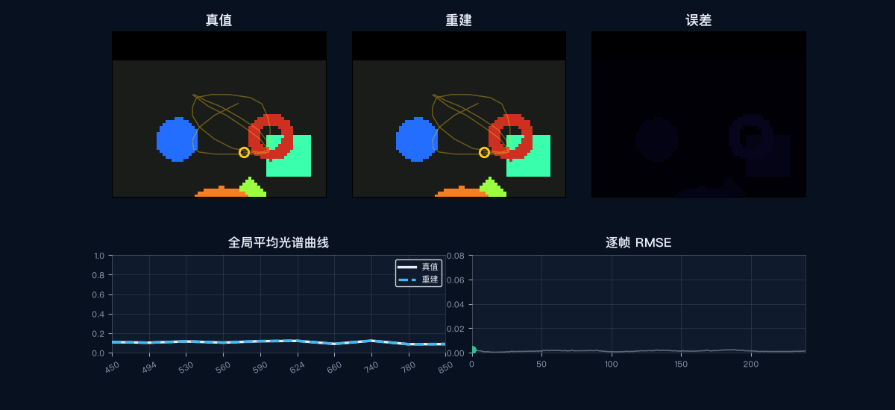
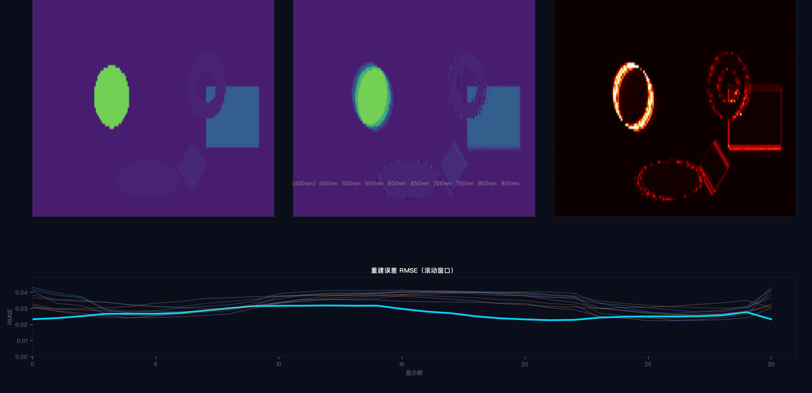

# ChromaCode

English | [中文](README.zh.md)

**Exploring multispectral imaging with one sensor and time-coded illumination.**

ChromaCode is a multispectral imaging research project. It encodes illumination from different spectral bands over time, allowing their responses to share one sensor. Reconstruction then separates the mixed observations into band reflectances. With an area sensor, the same process can be applied per pixel to form a multispectral image.

*A simulated example: reference image, reconstruction, and error map, from left to right.*

## What the project explores

- **Encoded acquisition:** multiple illumination bands share a sensing path and are separated during reconstruction.
- **Per-pixel reconstruction:** spectral recovery is extended from a single point to images, exploring multispectral imaging and video.
- **Two processing modes:** streaming demodulation updates continuously; block reconstruction combines an exposure sequence and returns a result for that time window.
- **Calibration and background modelling:** reference captures and background models can reduce specific errors when their assumptions hold.

The output is effective reflectance for the specified LED illumination bands, not an unrestricted continuous spectrum. A block result is not an independent multispectral measurement for every camera frame.

## Simulated examples

The figures below show band errors and selected-pixel reconstructions from simulations. They illustrate particular synthetic scenes, not accuracy across all materials, lighting, or motion.

*Simulation example: root-mean-square reflectance error by spectral band.*

*Simulation example: reference and reconstructed band values for selected pixels.*

### Dynamic scene

*Band-by-band reconstruction and error for a synthetic moving scene, not a real-world motion experiment.*

### Streaming output

*A simulated single-pixel mixed signal and streaming band estimates.*

## Current progress

- **Background and timing:** studying how illumination coding, exposure timing, and ambient interference affect reconstruction.
- **Channels and dynamics:** comparing channel counts under fixed light and time budgets and exploring models for changes within a window; more channels or more complex models do not guarantee better accuracy.
- **Computation and memory:** in one single-threaded CPU measurement, reconstructing a synthetic 128-frame uint16 block at 1920 × 1080 pixels and 32 bands took a median **0.349 s**, with **0.97 GB** peak process memory. Timing includes input conversion but excludes camera acquisition, I/O, model setup, and calibration; it is not an end-to-end video frame rate.

## Status and contact

The project is under research. The results shown here are simulated and do not establish real-camera accuracy or deployment readiness. Agriculture, industrial inspection, cultural-heritage analysis, and robotic vision are potential applications.

This repository hosts the project overview, images, and demos; source code and technical documentation are not published here. For collaboration or licensing enquiries, please open an issue.
