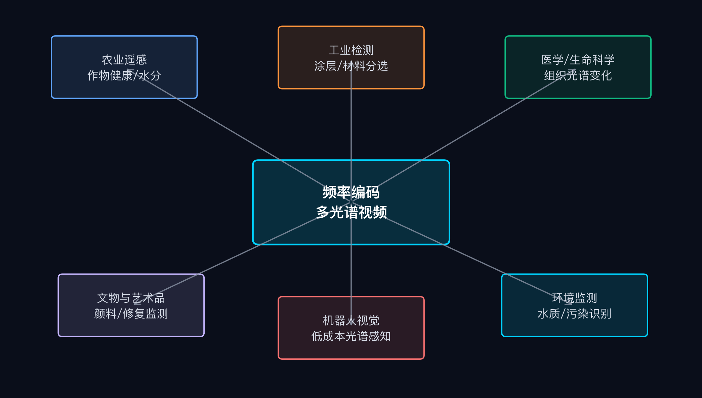

# ChromaCode

**Multi-spectral video through a single detector.**

ChromaCode explores how time-coded illumination and a single sensor can recover reflectance in multiple spectral bands. The reconstruction can run independently across pixels of an area sensor. The project includes both streaming demodulation and block-based reconstruction; their latency and assumptions differ.

*A simulated example: reference reflectance, recovered reflectance, and absolute error.*

## What it does

- **One sensor, multiple bands.** Encoded illumination shares one acquisition path; reconstruction separates the measured band responses.
- **Per-pixel reconstruction.** The same approach can be applied across an image, subject to acquisition, memory and computation limits.
- **Streaming and block modes.** Streaming updates continuously; block reconstruction combines multiple exposures and produces a result for a time window.
- **Calibration and background modelling.** Reference captures and nuisance models can reduce specific sources of error when their assumptions hold.

The reported outputs are LED-band effective reflectances, not an unrestricted reconstruction of a continuous spectrum. A block result is not an independent multi-band measurement for every camera frame.

## Results

The images below show simulated examples, not camera measurements. They illustrate reconstruction quality for the chosen synthetic scenes and settings; they do not establish accuracy for all materials, motion, or lighting.

*Per-band reflectance RMSE for the illustrated simulation.*

Comparing selected pixels against their simulated references shows the recovered band values for those examples.

*Recovered vs. reference spectra sampled at three positions across the scene.*

## Reconstruction in motion

A simulated moving scene, reconstructed band by band. The trajectory makes motion visible; the error panel compares against simulated ground truth. This example does not validate real-world motion performance.

## Streaming output

The streaming path can update every sample rather than waiting for a full block. This simulated example shows a mixed signal and the corresponding band estimates.

## Applications

Potential applications include areas where spectral information is useful and measurement constraints favour a compact optical path.

Examples include agricultural sensing, industrial inspection, cultural-heritage analysis, robotics, and environmental monitoring. These are potential applications, not validated deployments.

## Recent research

- **Background robustness.** Optional background-aware coding and fitting reduce interference in selected simulations, but can also amplify noise when the assumed background is wrong.
- **Channel count and motion.** More bands compete for a fixed light and time budget. A time-varying block model improves some simulated gradual changes, while abrupt changes can be worse and require additional observations.
- **Full-HD computation.** On one CPU, reconstructing a synthetic 128-frame uint16 block at 1920 × 1080 pixels and 32 bands took a median **0.349 s**, including integer conversion, with **0.97 GB** peak process memory. This excludes acquisition, camera I/O, setup and calibration; it is not an end-to-end video rate or a hardware accuracy measurement.

## Status

ChromaCode is under active development. The results here are simulated; no real-camera accuracy or deployment claim is made. Source code and technical documentation are not published in this repository; it hosts the project overview, visual results, and demos only.

## Contact

For collaboration or licensing enquiries, open an issue or reach out directly.
