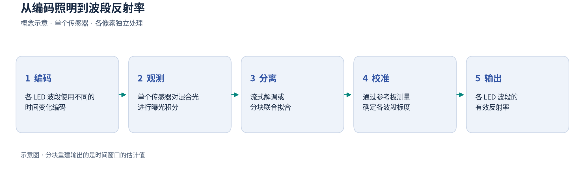
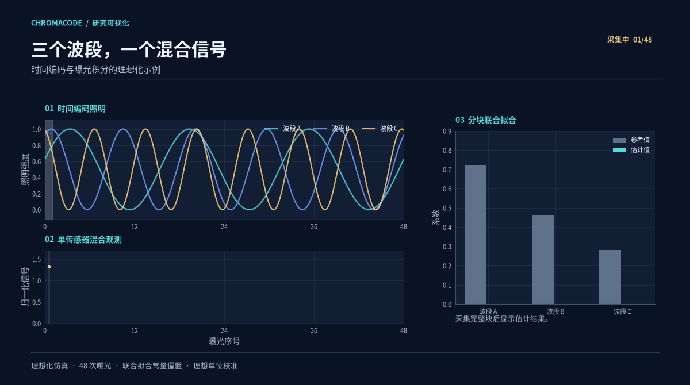
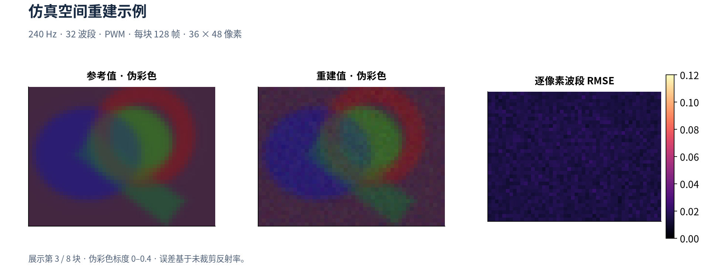
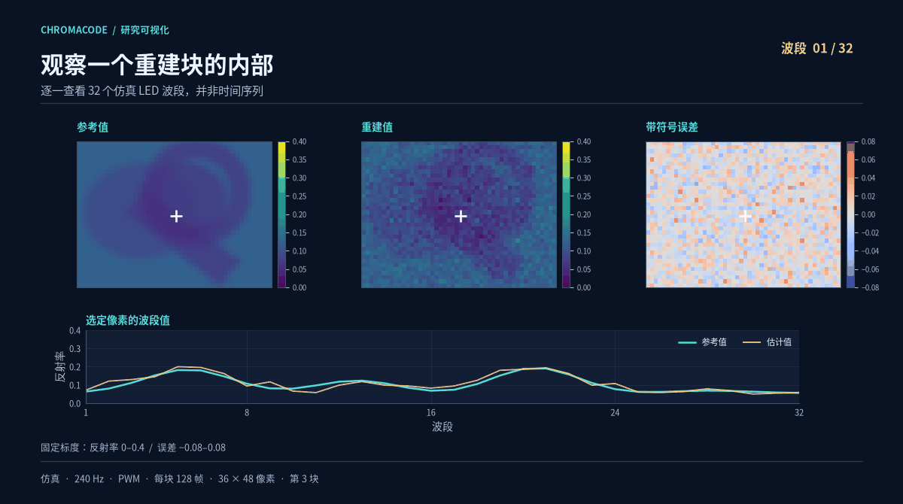
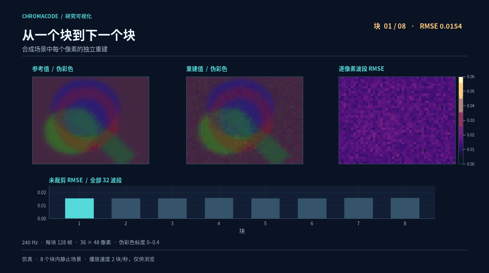
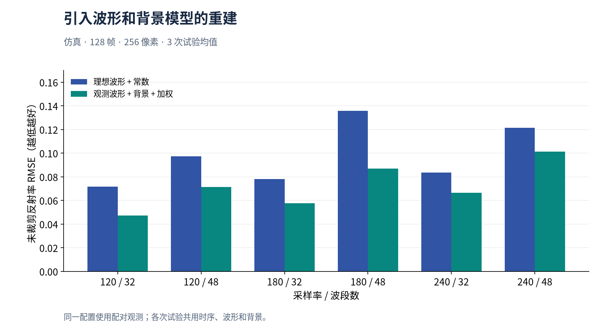
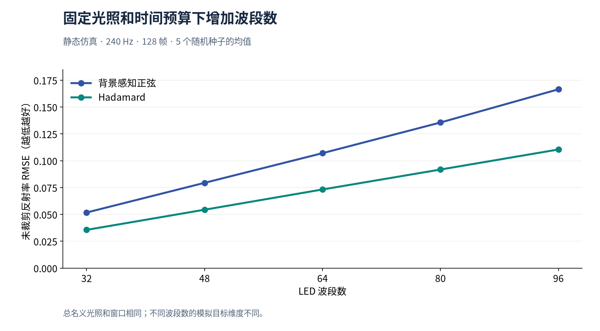
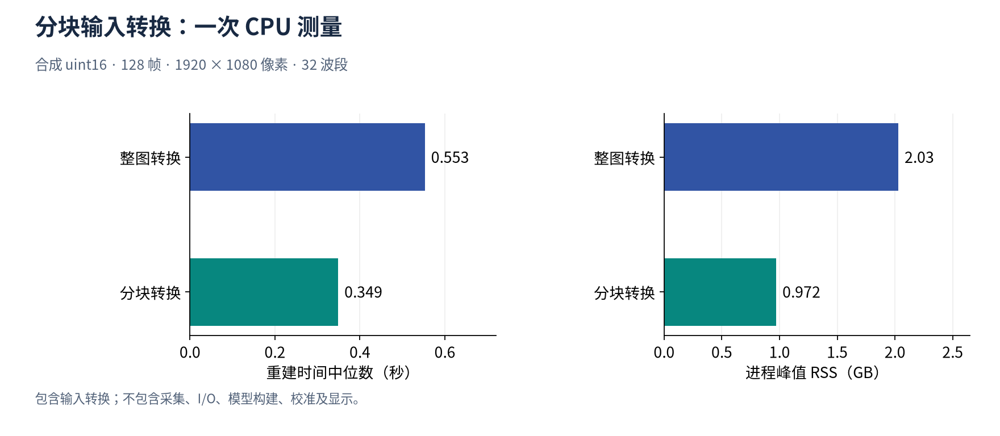

# ChromaCode

[English](README.md) | 中文

**通过时间编码照明与单个传感器重建多波段反射率。**

ChromaCode 探索如何让多个 LED 照明波段共用一条传感路径：各波段随时间按不同方式调制，接收器从混合观测中分离它们的贡献，再通过参考采集估计波段反射率。对于面阵传感器，同一方法可以独立应用于各个像素。

> **研究状态：**下文的重建和精度结果来自使用假设硬件参数的仿真；CPU 时间来自合成输入的软件基准。它们均不能证明真实相机精度或端到端视频性能。



## 重建的是什么？

输出是**所配置 LED 照明波段的有效反射率**。每个值受到 LED 光谱、传感器响应、光路和校准的共同影响；它不是任意连续光谱，也不是高分辨率光谱测量。传感器可以是单点探测器，也可以是相机面阵：使用一个传感器不意味着图像只由一个像素形成。

项目联合研究编码、校准、信号分离、通道数量、时间变化及计算代价。农业、工业检测、文化遗产分析和机器人视觉是潜在研究方向，并非已验证的部署场景。

## 工作原理

### 观测与校准

每次曝光时，传感器对所有开启 LED 的反射光进行积分。对于单个像素、且窗口内场景近似不变的情况，可以用以下简化模型描述：



*理想无噪声示意：对三个波段进行 48 次曝光积分观测，并联合拟合常量偏置。完整块采集后才显示估计值；播放速度不代表系统速度。*

```math
y_t = \sum_{c=1}^{C} A_{tc}a_c + \sum_{j=1}^{P} B_{tj}b_j + \varepsilon_t,
\qquad A_{tc} = \int_{\text{exposure }t} L_c(\tau)\,d\tau.
```

其中 `y` 是混合观测，`L` 是各波段的照明波形，`a` 是包含光路和传感器增益的波段系数，`B` 是背景项，`ε` 表示噪声和模型失配。曝光积分设计矩阵可以来自理想波形，也可以由分别测得的 LED 光学轨迹构造。已知波段反射率的参考板用于确定目标系数的标度；参考与目标采集之间的照明、几何或传感器增益变化仍会引入误差。

分块重建联合拟合照明列和干扰列，并可使用独立估计的帧噪声方差进行加权。求解采用 SVD 并检查秩和条件数：**增加观测或背景列并不自动保证设计可辨识**。帧权重是所有像素共用的近似，不是逐像素 Poisson 似然。

### 编码与处理方式

| 环节 | 方法 | 主要取舍 |
|---|---|---|
| 照明 | 不同实验中探索正弦/IQ、PWM、Hadamard 和时分编码。 | 曝光积分后编码仍需可区分，并满足功率限制。 |
| 流式 | 锁相解调结合 FIR 或 IIR 滤波，随采样持续更新波段估计。 | 更新频率不等于可恢复的场景变化带宽；滤波存在建立时间和延迟。 |
| 分块 | 联合拟合一段曝光序列，再校准各波段系数。 | 输出对应一个时间窗口，不是每个相机帧独立测得的多光谱图。 |
| 背景 | 与照明一起拟合选定的偏置、漂移或已知频率闪烁。 | 额外列消耗自由度，可能放大噪声或与照明列冲突。 |
| 时变模型 | 可为每个波段增加窗口内线性变化项。 | 参数更多，通常无法恢复突变或真实运动。 |

例如，240 Hz 下的 128 帧对应名义 **0.533 秒的不重叠块周期**，还未包含重建和系统其他延迟。缩短窗口可能降低延迟，但观测与光子也会减少。选频器可以利用已知背景和噪声选择正弦载波；它采用贪心搜索，不保证全局最优。

## 仿真重建示例



该示例使用 32 个 PWM 编码波段、240 Hz 下每块 128 帧、12-bit 传感器模型和 **36 × 48 像素的合成场景**。各像素的带噪观测与重建相互独立。物体在块与块之间改变位置，但每块内保持静止；这不是连续运动测试。

图中展示 8 块中的第 3 块。伪彩色由三个固定波段组构成，使用共同的 0–0.4 显示标度，**不是自然 RGB 图像**。误差图是各像素跨波段的 RMSE，基于未裁剪反射率计算。全部 8 块的仿真 RMSE 为 **0.0154**。该场景包含独立参考采集、散粒/读出噪声、曝光抖动与 LED 时钟偏差，但不包含下方实验使用的环境闪烁；不同实验的结果不应直接比较。



*逐一展示同一块的 32 个波段，并非时间序列。十字标记的像素对应下方曲线；波段值之间的连线仅用于观察，不代表连续光谱。带符号误差为重建值减参考值；图像颜色按固定标度裁剪显示，原始结果未裁剪。*



*8 个独立重建块的序列，每块 RMSE 基于所有像素和波段计算。播放速度为 2 块/秒，仅供浏览，不是实际采集或处理速度。*

## 精度与通道数的取舍

下文 RMSE 均为相对仿真真值的**未裁剪反射率 RMSE**；`0.01` 约对应一个反射率百分点。这些是特定场景下的汇总结果，不是逐波段精度保证。

### 波形与背景建模



每组配置包含 128 帧、256 像素和 3 次试验。对比的接收器使用相同目标观测与平均参考板。合成照明含相位偏差、谐波和响应曲率；光学轨迹无噪声并已同步。曝光时长变化，环境光含已知 50 Hz 闪烁。近似权重使用参考板和固定目标反射率先验，不使用目标真值。各次试验共用时序、波形和背景，仅重新生成目标反射率及传感器噪声。

| 采样率 | 波段数 | 理想波形 + 常数背景 | 观测波形 + 积分背景 + 加权 |
|---|---:|---:|---:|
| 120 Hz | 32 | 0.07157 | 0.04719 |
| 120 Hz | 48 | 0.09738 | 0.07130 |
| 180 Hz | 32 | 0.07815 | 0.05769 |
| 180 Hz | 48 | 0.13578 | 0.08702 |
| 240 Hz | 32 | 0.08342 | 0.06639 |
| 240 Hz | 48 | 0.12142 | 0.10137 |

在这些配置中，组合模型的 RMSE 降低约 **16–36%**。该对照同时改变了多个环节，不能证明每一步独立加入时均有效。不同采样率对应不同观测时长；未知闪烁频率、带噪光学监测和真实硬件仍需测试。

### 增加波段数量



另一组静态仿真固定 240 Hz、每块 128 帧、名义曝光占空比 0.8，以及 120 万电子/秒的总平均白信号速率。每组使用 128 像素、12-bit ADC 模型、8 万电子/秒且调制幅度为 80% 的已知 50 Hz 环境闪烁、4 次参考采集和 5 个随机种子。每路 LED 峰值限制为 10 万电子/秒，本组均未触及限制。

| LED 波段数 | 背景感知正弦 | Hadamard |
|---:|---:|---:|
| 32 | 0.05178 | 0.03562 |
| 48 | 0.07943 | 0.05439 |
| 64 | 0.10706 | 0.07325 |
| 80 | 0.13563 | 0.09182 |
| 96 | 0.16656 | 0.11050 |

表中为 5 个种子的均值；50 次运行均成功，目标与参考均未饱和。5 个种子不足以给出可靠置信区间。在固定总光照与时间下，该仿真中更多波段分配到的单路光照减少，整体误差上升。不同波段数使用不同维度的合成目标，并非同一组波段的配对测量。**仿真 96 波段不代表已验证的硬件上限或能力。**

### 窗口内的变化

另一组仿真比较静态和线性时变拟合，每行使用相同编码和观测。指标为相对曝光时长加权块均值的 RMSE，取 3 个随机种子的均值；这些示例均使用 240 Hz、128 像素、12-bit ADC 模型及已知 50 Hz 背景。

| 帧数 / 波段数 | 编码 | 合成变化 | 静态拟合 | 线性拟合 |
|---|---|---|---:|---:|
| 64 / 16 | Hadamard | 静态 | 0.03274 | 0.03343 |
| 64 / 16 | Hadamard | 线性变化 | 0.05091 | 0.03334 |
| 64 / 24 | 时间感知正弦 | 阶跃 | 0.09536 | 0.21847 |
| 128 / 32 | Hadamard | 线性变化 | 0.05275 | 0.03698 |
| 128 / 48 | Hadamard | 阶跃 | 0.08131 | 0.08827 |

线性模型改善了部分线性变化，但会增加静态场景的噪声，对阶跃也可能更差。更大范围的扫描中，432 次运行有 288 次成功、144 次因自由度不足、秩不足或条件数不佳而被拒绝。这些是重复的仿真配置，不是独立的硬件故障；通过条件数检查也不代表动态精度得到保证。

## 重建性能



以下是**纯软件 CPU 对照**，不是成像精度实验。输入为合成随机 `uint16` 数据，每块 128 帧、1920 × 1080 像素、32 个输出波段。输入转换和重建使用 float32；设计矩阵及校准准备预先完成。

| 输入转换方式 | 每块时间中位数 | 进程峰值 RSS |
|---|---:|---:|
| 整图转换为 float32 | 0.553 秒 | 2.03 GB |
| 按 4096 像素分块转换 | 0.349 秒 | 0.972 GB |

本机测量使用单线程 Intel i9-9900K、Python 3.12.16、NumPy 2.5.5 和 OpenBLAS 0.3.34。两种路径分别在独立进程中预热后测量 5 次，未交错运行，也未隔离共享主机负载。峰值 RSS 包含初始化、预热和精度检查。两种路径的前 1,024 像素相对 float64 接收器的最大绝对差均为 `5.83 × 10⁻⁶`；这是数值对照，**不是**物理反射率误差。

计时包含输入转换、重建、输出分配及校准比值，不包含采集、相机 I/O、设计矩阵构建、SVD、参考板拟合或显示。残差诊断未启用；输入及完整输出数组仍保留在内存中。这些数字不代表相机到显示的延迟或实时视频吞吐。

## 局限与下一步

- **硬件：**需要实测 LED 波形、传感器光谱响应、同步、丢帧、饱和与温漂。
- **校准：**参考噪声、几何、非线性及参考与目标之间的变化均可能产生偏差；拟合背景不能消除其光子散粒噪声。
- **动态性：**静态分块模型假设窗口内变化很小；线性项只能近似有限变化，不能恢复逐帧多光谱图像。
- **扩展性：**必须联合评估通道数、光照预算、条件数、采集时间和运动敏感性，单组结果不能自动推广。
- **验证：**需要真实目标和相机实验，才能评估实际精度和部署可行性。

## 关于本仓库

本仓库用于项目介绍和可视化展示，核心实现及技术文档未在此发布。如有合作或许可意向，欢迎通过 Issue 联系。
